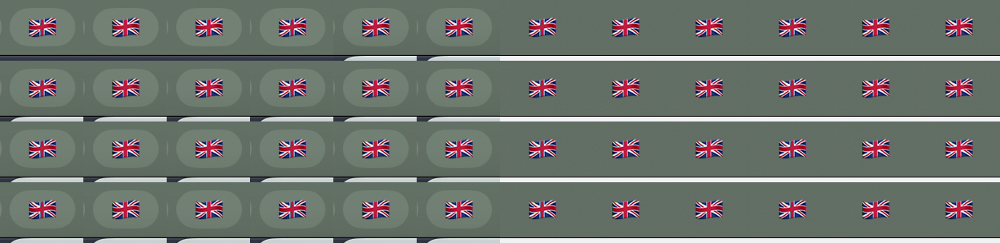

# Bzz: нажатие на значок без системного овала

Проверено 21.11.2026, 20:44 MSK, на Air с macOS **27.2.1 (26B131)**, один экран Retina 2×, 1710×1107 pt. Исходная версия — `5d33b7e`, установленная Bzz 0.9.2. Исправленная локальная сборка подписана `Taskz Local Signing` и установлена в `/Applications/Bzz.app`. Thaw после временной остановки возвращён; оба итоговых прогона выполнены с работающим Thaw.

При обычном mouseDown с удержанием 0.4 с овал воспроизвёлся. В исходной записи он присутствует в **207 из 359 кадров**, кадры **121–327**, PTS 2.016667–5.466667 с. Это включает удержание и открытое меню после отпускания.

Слева — 24 последовательных кадра исходной сборки, справа — 24 последовательных кадра исправленной сборки. В центре каждого фрагмента находится флаг **Bzz**.



## Изменение

Адаптирован [эталон SyncthingMacOS, коммит 7af7bbb](https://github.com/scorpionishe/SyncthingMacOS/blob/7af7bbb0645c48ec095697e7fb240b68a7577558/tests/menubar/status-item-panel.md). Над границами штатной кнопки заранее размещена отдельная `borderless/nonactivating` NSPanel ввода с альфой 0.002. Она не получает клавиатурный фокус и исключена из Accessibility. Дочернее окно следует за геометрией кнопки и скрывается при исчезновении якоря. Модификаторы переводят его в `ignoresMouseEvents`; обход сохраняется и за пределами исходных границ при перетаскивании.

Обычный mouseUp внутри области и штатная кнопка вызывают одно действие. Сохранены отрисовка флагов/паузы, исходные NSMenuItem, их отметки, статистика, сочетания и Go-обработчики. Существующее **NSMenu** открывается отдельно через `popUpMenuPositioningItem:atLocation:inView:nil`, без привязки к выделяемой кнопке. Данные меню обновляются до активации Bzz, чтобы исключение приложения относилось к прежнему активному приложению. После закрытия возвращается прежняя активность. Для штатного клавиатурного/AX-входа на macOS 27 используется `NSStatusItemExpandedInterfaceDelegate`.

## Итог проверки

| Сценарий | Наблюдаемый результат |
|---|---|
| Четыре удержания 0.4 с, mouseDown → hold → mouseUp | Каждый раз меню открывается после отпускания; овала в проверенных кадрах обычного ввода нет. |
| Повторный короткий клик, три раза | Меню закрывается, повторного открытия на том же отпускании нет. |
| Escape | Открытое меню закрывается. Проверено событием клавиатуры через `agent-desktop --headed press escape` и исчезновением окна меню. |
| AXPress штатного значка | Открывает меню. Нативный AX-вызов возвращает `cannotComplete` (-25204) из-за tracking меню; результат установлен по появлению окна, а не по коду возврата. |
| Стрелка вниз, Return | Вызвана пауза: флаг сменился на 💤, ширина AXMenuExtra 39 → 42 pt. Тем же способом Bzz снова включён, ширина вернулась к 39 pt. |
| Cmd-drag | События доходят до нативного перетаскивания, обычное меню не открывается; последующий обычный клик работает. **Сохранение новой позиции не подтверждено:** синтетический жест возвращает значок на прежнее место и в исходной, и в исправленной сборке. Физический перенос остаётся для ручной проверки. |
| Сборка и Go | `make install DEV_SIGN_IDENTITY='Taskz Local Signing'`, `go test ./...`, `git diff --check` и проверка подписи прошли. |

Первая итоговая запись содержит 1015 кадров, из них 808 вне нативного Cmd-drag; овал: **0/808**. Повторная запись финальной сборки содержит **1018 кадров**, из них **808** вне Cmd-drag; овал: **0/808**. Все декодированные кадры обработаны, промежуточные кадры не подставлялись. Частота потока `60/1`; в повторной записи два интервала по 33.3 мс вместо 16.7 мс (после PTS 5.366667 и 12.950000), вне интервалов mouseDown–mouseUp. Привязка журнала событий к видео через ffmpeg progress имеет погрешность до 0.12 с.

Детектор в каждом кадре находит флаг по цветным пикселям Union Jack и сравнивает полосы фона слева и справа от него: ±30 px внутри овала и ±48 px снаружи. Порог — больше 5 уровней зелёного канала с обеих сторон. На исходном овале разность составляет 17. Кадры Cmd-drag помечены отдельно: нативное перетаскивание может менять прозрачность и положение изображения и не относится к обычному клику. Другие экраны, полноэкранные Spaces и старые версии macOS не проверялись.

## Артефакты

- [Каждый кадр исходной записи](evidence/before-frames.csv).
- [Каждый кадр финальной записи](evidence/after-frames.csv), включая PTS, положение флага, ошибку его поиска и обе разности фона.
- [Журнал нажатий и состояний меню](evidence/events.json), [результат](evidence/result.json).
- [24 кадра до](evidence/before-hold.png), [24 кадра после](evidence/after-hold.png).
- Локальные видео 60 кадров/с: [до](../../build/menubar/before/bzz-60fps.mp4), [после](../../build/menubar/final/bzz-60fps.mp4), [Cmd-drag](../../build/menubar/final/command-drag.mp4). Видео и исходные lossless MOV остаются в игнорируемом `build/menubar/`.

## Повторить

Нужны разблокированный экран 2×, установленная подписанная сборка, разрешения Accessibility/Screen Recording, Swift, ffmpeg, numpy и agent-desktop. Закрой меню Bzz и не трогай мышь во время автоматического прогона:

```sh
python3 tests/menubar/check-press.py build/menubar/recheck --drag
```

Скрипт отправляет mouseDown/mouseUp через WindowServer с удержанием. После наведения он ждёт стабильной геометрии: Thaw и индикатор записи способны перемещать значки. Проверяется открытие/закрытие нативного окна меню, а также каждый кадр записи. `--drag` проверяет обход области ввода и последующее открытие меню; успешное закрепление новой позиции этот флаг не утверждает.
